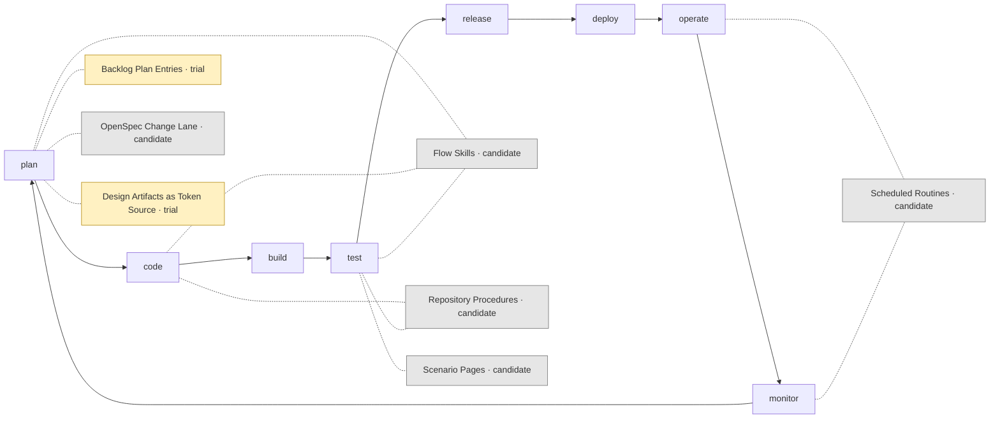

# AI Adoption Map

```meta
status: candidate
index: root
type: adoption-map
```

How this repository is built with AI, organized by the DevOps loop. The practices live one
chapter each in the usage files below; this file is the map. The tools themselves are
registered in `.devbook/tech/`, never here.

## Usage files

| File | Covers |
| --- | --- |
| `01-plan.md` | Specifying work: chapters, backlog items, and their approval |
| `02-code-test.md` | Implementing and validating a change |
| `03-build-release.md` | Getting a change through CI and into a release |
| `04-operate-monitor.md` | Running the system and feeding what it shows back into planning |

## The loop



Seven usages are recorded. Five are `candidate`: the 1.19 update on 2026-10-06 wired the
delivery flows, the repository's procedures, and a schedule selection, the 1.25 update on
2026-10-13 created the six routines that selection names, devbook ships the scenario page
skills and their tools, refreshed by the 1.26 update on 2026-10-15, and the 1.28 update on
2026-10-21 set up the OpenSpec change lane. Nobody works through any of them yet. Two are `trial`: since 2026-10-21 the `finance-setup` plan's entries are run here
from the Backlog app, and one of them turned the Finance App Design artifact into `design/` tokens. `build`, `release`, and `deploy` are empty, and that is the finding, not a gap to fill
with a tool name.

## Status ladder

`candidate` → `trial` → `adopted` → `hold` → `retired`, per `devbook-ai.md`. Promote a
chapter when its **Adopted by** line says the team actually works this way, and record what
is dropped as `retired` rather than deleting it.
