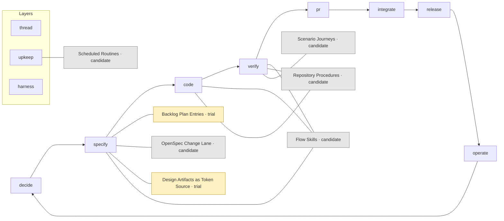

# AI Adoption Map

```meta
rating: candidate
index: root
type: adoption-map
```

How this repository is built with AI, organized by the seven-stage delivery path and the three
layers beneath it. The practices live one chapter each in the usage files below; this file is
the map. The tools themselves are registered in `.devbook/tech/`, never here.

## Usage files

| File | Covers |
| --- | --- |
| `01-plan.md` | Specifying work: chapters, backlog items, and their approval |
| `02-code-test.md` | Implementing and validating a change |
| `03-build-release.md` | Getting a change through CI and into a release |
| `04-operate-monitor.md` | Running the system, feeding what it shows back, and the scheduled routines that keep the repository healthy |

## The path



Seven usages are recorded. Five are `candidate`, and nobody works through any of them yet:

- The 1.19 update on 2026-10-06 wired the delivery flows, the repository's procedures, and a
  schedule selection.
- The 1.25 update on 2026-10-13 created the six routines that selection names.
- devbook ships the scenario journey skills and their tools, last refreshed by the 1.34 update on
  2026-11-03.
- The 1.28 update on 2026-10-21 set up the OpenSpec change lane.

Two are `trial`:

- Since 2026-10-21 the `finance-setup` plan's entries are run here from the Backlog app.
- One of those entries turned the Finance App Design artifact into `design/` tokens.

`decide`, `integrate`, `release`, and `operate` are empty, and so are the `thread` and `harness`
layers. That is the finding, not a gap to fill with a tool name. Scheduled Routines sit on `upkeep`
rather than at `operate`: they keep the repository healthy and watch no running product.

## Rating ladder

`candidate` → `trial` → `adopted` → `hold` → `retired`, per `devbook-ai.md`. Promote a
chapter when its **Adopted by** line says the team actually works this way, and record what
is dropped as `retired` rather than deleting it.

## Reading and extending

A file groups chapters and places none; a chapter's place is its `stage` and `layer` fields. A new
or moved usage updates the table and the picture in the same change, per `devbook-ai.md`.
