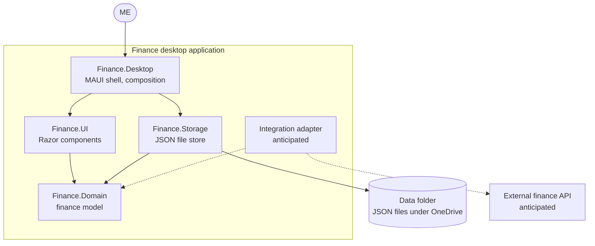
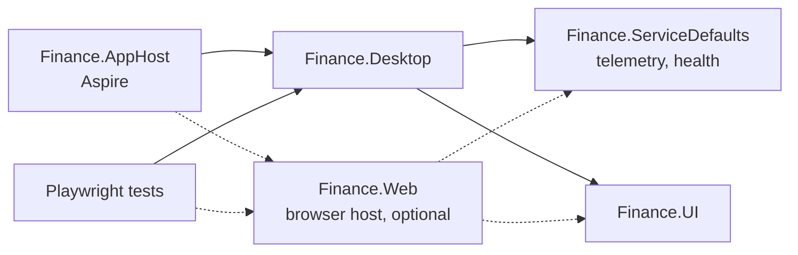

# 05. Building Block View

```meta
status: draft
related: [.devbook/arc42/04-solution-strategy.md, .devbook/domain/finance/context.md]
```

```annotation
kind: suggestion
author: "claude/chapter-review"
date: 2026-10-21
body: |
  [minor] Folder rule: Level 1 and Development Harness are drawn as Mermaid flowcharts, but devbook-arc42.md asks for building blocks as container or component views of workspace.dsl, embedded as an image with a c4: key, with Mermaid only inside one element. workspace.dsl has no container or component yet; its only view is business-context. Settle it by modelling Finance.Desktop as a container with Finance.UI, Finance.Domain, Finance.Storage (and the anticipated adapter) as components, plus the development projects, adding a component view, and embedding it here in place of the Mermaid.
```

Finance is one deployable application built from a few .NET projects. The project names
below are the planned ones; no code exists yet, and the first implementation may rename them.
What the `finance` model contains is the authority of
[`.devbook/domain/finance/`](../domain/finance/context.md), so this view names the model
project without restating its contents.

## Level 1

```meta
status: draft
related: [.devbook/arc42/03-context-and-scope.md#business-context, .devbook/arc42/adr/desktop-stack.md, .devbook/arc42/adr/storage.md]
```



```annotation
kind: suggestion
author: "claude/prose-check"
date: 2026-10-21
quote: "flowchart TB"
body: |
  [minor] Prose (Mermaid architecture): The flowchart draws ME, the application, the data folder and the external API; use a container view in 05 (and add the missing elements to workspace.dsl).
```

| Block | Responsibility |
| --- | --- |
| `Finance.Desktop` | The .NET MAUI Blazor Hybrid executable. It opens the window, hosts WebView2, and wires the other projects together. |
| `Finance.UI` | A Razor class library with every page and component. It holds no file access, so another host can render it. |
| `Finance.Domain` | The `finance` model and the store interface it needs. It references no UI, file, or network library. |
| `Finance.Storage` | Implements the store interface against JSON files in the data folder, per [the storage record](adr/storage.md). |
| Integration adapter | Not built. See [Integration Seam](#integration-seam). |

The model sits at the centre and depends on nothing else in Finance. Storage depends on the
model, never the reverse, so the file format can change without touching a rule.

```annotation
kind: question
author: "claude/chapter-review"
date: 2026-10-21
quote: "The model sits at the centre and depends on nothing else in Finance."
body: |
  [major] Gaps: no block owns the application code between the UI and the model. adr/error-handling.md says "the application code translates it into a failed Result before it reaches the UI", 08#user-interface puts "a small UI service per feature" between components and the model, and 06#save-a-change needs something to call the store after the model accepts a change. Finance.UI holds no file access, Finance.Desktop is composition only, and Finance.Domain is the model plus its port. Which project holds the per-feature services that apply a change, return a Result, and call the store port? Settle it by naming that block in the table and the diagram (a Finance.Application project, or a stated folder in an existing one) and adding its reference rules to adr/modularity.md.
```

## Development Harness

```meta
status: draft
related: [.devbook/arc42/07-deployment-view.md#development, .devbook/arc42/08-crosscutting-concepts.md#testability]
```



```annotation
kind: suggestion
author: "claude/prose-check"
date: 2026-10-21
quote: "flowchart LR"
body: |
  [minor] Prose (Mermaid architecture): The flowchart draws the projects and the test tools as parts; use a container or component view in 05 (add them to workspace.dsl).
```

These projects exist only for development and never ship to the user.

```annotation
kind: flag
author: "claude/chapter-review"
date: 2026-10-21
quote: "These projects exist only for development and never ship to the user."
body: |
  [major] Truth: `Finance.ServiceDefaults` ships. The diagram above has Finance.Desktop --> Finance.ServiceDefaults; adr/orchestration.md says ServiceDefaults reaches the MAUI head through an `IMauiInitializeService`; adr/observability.md keeps export off in production only because `OTEL_EXPORTER_OTLP_ENDPOINT` is unset, which presumes the wiring is in the installed build; 07#production says "the telemetry ServiceDefaults wires has no collector to send to"; and 12 (Development harness) leaves ServiceDefaults out. Settle it by excluding ServiceDefaults from this sentence and saying it is compiled into Finance.Desktop and exports nothing outside the AppHost, or, if it must not ship, by deciding how Desktop references it only in development and updating orchestration, observability, and 07.
```

- `Finance.AppHost` is the Aspire entry point that starts the application and its dashboard.
- `Finance.ServiceDefaults` adds OpenTelemetry and health checks to every project that references it.
- `Finance.Web` is optional. It hosts `Finance.UI` in an ordinary browser over a throwaway data folder, so Playwright can run without the MAUI shell. It is a test harness, not a second channel, and whether to build it is open in [11. Risks and Technical Debt](11-risks-and-technical-debt.md#open-questions).

```annotation
author: "claude/chapter-review"
date: 2026-10-21
quote: "adds OpenTelemetry and health checks to every project that references it"
body: |
  [minor] Truth: adr/orchestration.md says the guideline's "health checks per service" do not apply because Finance has no services, while this bullet and 12 (ServiceDefaults) say ServiceDefaults adds health checks. Settle it by deciding whether ServiceDefaults registers health checks for the desktop head and aligning this bullet, the glossary, and the record.
```

```annotation
kind: suggestion
author: "claude/prose-check"
date: 2026-10-21
quote: "`Finance.AppHost` is the Aspire entry point that starts"
body: |
  [minor] Prose (repeated definition): The glossary defines AppHost; point at it instead of defining it again.
```

```annotation
kind: suggestion
author: "claude/prose-check"
date: 2026-10-21
quote: "`Finance.ServiceDefaults` adds OpenTelemetry and health checks"
body: |
  [minor] Prose (repeated definition): The glossary defines ServiceDefaults; point at it instead of defining it again.
```

```annotation
kind: suggestion
author: "claude/prose-check"
date: 2026-10-21
quote: "It is a test harness, not a second channel, and whether"
body: |
  [minor] Prose (overlong sentence): The sentence says what Finance.Web is and that building it is open; split it into two.
```

## Integration Seam

```meta
status: draft
related: [.devbook/arc42/11-risks-and-technical-debt.md#open-questions, .devbook/arc42/08-crosscutting-concepts.md#external-integration]
```

Finance will probably fetch data from an external API one day, such as bank transactions or
market prices. Nothing about that API is chosen. The architecture reserves only where it
attaches: a separate adapter project that translates the external data into the `finance`
model's own terms. The adapter acts as an anti-corruption layer, so no external type reaches
`Finance.Domain`.

```annotation
kind: suggestion
author: "claude/prose-check"
date: 2026-10-21
quote: "The adapter acts as an anti-corruption layer"
body: |
  [minor] Prose (repeated definition): The glossary's Integration adapter entry already says this; cut the sentence or link the term.
```

```annotation
kind: suggestion
author: "claude/prose-check"
date: 2026-10-21
quote: "Finance will probably fetch data"
body: |
  [minor] Prose (hedge): The hedge "probably" sits in a sentence stating a fact; write "Finance may fetch data from an external API one day" or cut it.
```

The adapter, its trigger, and how it stores credentials get designed when a concrete API is
picked. That choice will need its own decision record.
