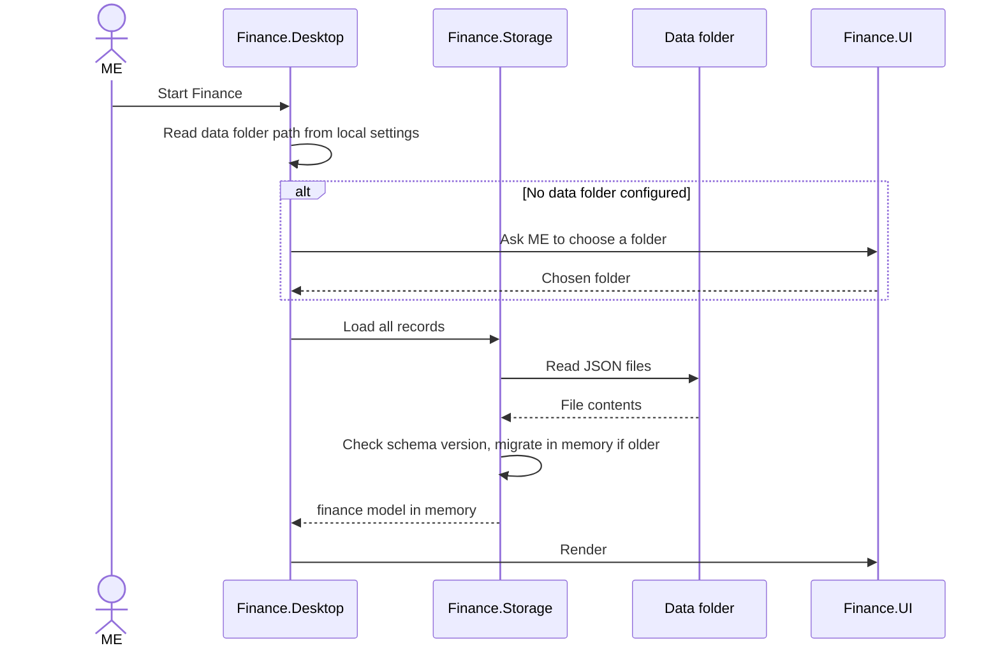
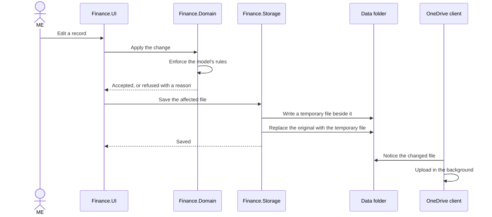
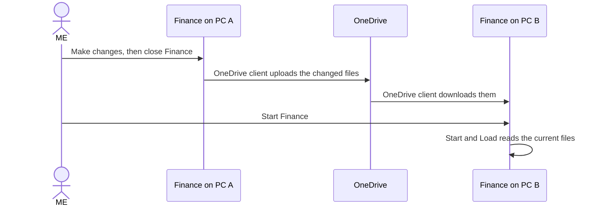
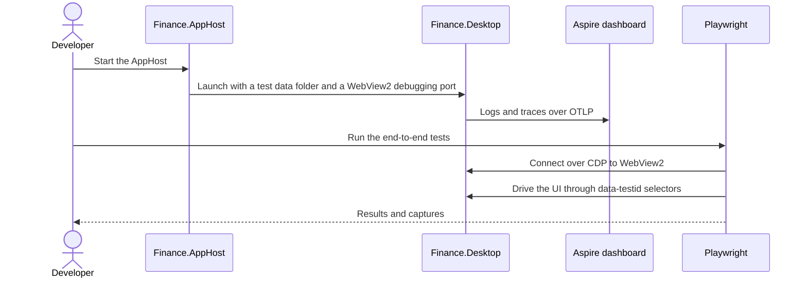

# 06. Runtime View

```meta
status: draft
related: [.devbook/arc42/05-building-block-view.md]
```

```annotation
kind: suggestion
author: "claude/chapter-review"
date: 2026-10-21
body: |
  [minor] Folder rule: all four scenarios are Mermaid sequence diagrams, while devbook-arc42.md asks for runtime scenarios as dynamic views of workspace.dsl embedded here, with Mermaid only inside one element. workspace.dsl has no container, component, or dynamic view yet. Settle it once 05 has its component view (see the note on 05) by adding a dynamic view per scenario and embedding each in its section.
```

Four scenarios show how the building blocks from chapter 5 work together at run time.

## Start and Load

```meta
status: draft
related: [.devbook/arc42/05-building-block-view.md#level-1, .devbook/arc42/08-crosscutting-concepts.md#configuration]
```



```annotation
kind: suggestion
author: "claude/prose-check"
date: 2026-10-21
quote: "participant Desktop as Finance.Desktop"
body: |
  [minor] Prose (Mermaid architecture): The sequenceDiagram passes a request between parts; use a dynamic view in 06 (add the parts to workspace.dsl).
```

Finance loads every record into memory at start. A single person's finance records stay
small enough for that, and it keeps every later read local and instant. A file with a newer
schema version than the application knows stops the load with a message, so an old build
never overwrites data written by a newer one.

```annotation
kind: suggestion
author: "claude/chapter-review"
date: 2026-10-21
quote: "stops the load with a message"
body: |
  [minor] Gaps: the diagram shows only the missing-folder branch. 08#configuration says an invalid path fails the start; 11 R2 (an online-only placeholder opened offline), a file that does not deserialize (an exception per adr/error-handling.md), and conflict copies found on load (11 R1's mitigation) all happen in this flow and are not shown. Settle it by adding those outcomes as alt branches or naming each one in the paragraph below, with what ME sees.
```

## Save a Change

```meta
status: draft
related: [.devbook/arc42/adr/storage.md, .devbook/arc42/08-crosscutting-concepts.md#persistence]
```



```annotation
kind: flag
author: "claude/chapter-review"
date: 2026-10-21
quote: "UI->>Storage: Save the affected file"
body: |
  [major] Truth: this flow has `Finance.UI` call `Finance.Storage` directly. That contradicts 05#level-1, where the UI has no Storage dependency ("It holds no file access"; only `Finance.Desktop` wires Storage), 08#user-interface ("A component reaches the model through a small UI service per feature"), and adr/modularity.md, whose architecture tests would fail a UI-to-Storage reference. Settle it by routing the save through the store port in `Finance.Domain`, called by whichever block owns the per-feature service (see the open question on 05#level-1), and renaming the participant accordingly.
```

```annotation
kind: suggestion
author: "claude/prose-check"
date: 2026-10-21
quote: "participant OneDrive as OneDrive client"
body: |
  [minor] Prose (Mermaid architecture): The sequenceDiagram names ME and OneDrive, which are workspace elements; use a dynamic view in 06.
```

The model refuses an invalid change before anything touches disk. The replace step is what
makes a write atomic: a crash leaves either the old file or the new one, never half of each.
Finance does not wait for OneDrive, and works the same when OneDrive is offline or paused.

```annotation
kind: question
author: "claude/chapter-review"
date: 2026-10-21
quote: "Finance does not wait for OneDrive, and works the same when OneDrive is offline or paused."
body: |
  [major] Gaps: only the happy path is shown. The model accepts the change in memory before the write; when the write then fails (disk full, a file OneDrive has locked, both technical faults in adr/error-handling.md), memory is ahead of disk. Does the change roll back, retry, or stay pending with an error state? The flow also saves on every edit, while design/interaction-guidelines.md#auto-save saves when an edit settles. Settle it with an alt branch for a failed write, what the UI shows, and the trigger that matches the auto-save state machine.
```

## Continue on Another PC

```meta
status: draft
related: [.devbook/arc42/07-deployment-view.md#production, .devbook/arc42/11-risks-and-technical-debt.md#risks]
```



```annotation
kind: suggestion
author: "claude/prose-check"
date: 2026-10-21
quote: "participant Cloud as OneDrive"
body: |
  [minor] Prose (Mermaid architecture): The sequenceDiagram names ME and OneDrive, which are workspace elements; use a dynamic view in 06.
```

The hand-over works when Finance runs on one PC at a time and OneDrive has finished syncing.
Running it on two PCs at once, or starting before a download completes, can produce an
OneDrive conflict copy or stale data. [11. Risks and Technical Debt](11-risks-and-technical-debt.md#risks)
tracks that.

```annotation
kind: flag
author: "claude/chapter-review"
date: 2026-10-21
quote: "or starting before a download completes"
body: |
  [major] Truth: the worst outcome is missing. Finance loads every record at start, keeps them in memory, writes whole files, and nothing in 06 or 08 re-reads the folder while running. If Finance stays open on PC B while a change from PC A syncs down, B's next save of that file replaces A's newer version with B's stale in-memory copy. OneDrive sees two sequential edits and makes no conflict copy, so the loss is silent, and R1's mitigations (a marker file, detecting conflict copies on load) do not catch it. Settle it by naming the lost update here and in 11 R1, and deciding a guard: compare the file's last-write time or hash with what was loaded before replacing it, or watch the folder and reload.
```

## Development Run with Playwright

```meta
status: draft
related: [.devbook/arc42/07-deployment-view.md#development, .devbook/arc42/adr/desktop-stack.md]
```



```annotation
kind: suggestion
author: "claude/prose-check"
date: 2026-10-21
quote: "participant AppHost as Finance.AppHost"
body: |
  [minor] Prose (Mermaid architecture): The sequenceDiagram passes a request between parts; use a dynamic view in 06 (add the parts to workspace.dsl).
```

OTLP is the OpenTelemetry protocol, and CDP is the Chrome DevTools Protocol that WebView2
exposes. A test run points Finance at a throwaway data folder, never at the real OneDrive one.

```annotation
kind: question
author: "claude/chapter-review"
date: 2026-10-21
quote: "A test run points Finance at a throwaway data folder"
body: |
  [minor] Truth: here the Developer starts the AppHost and then runs the tests as a second step, while 10 Q8 ("no manual step") and adr/test-stack.md ("The AppHost starts the application for it") have the test run start the AppHost itself. adr/orchestration.md also assigns every port per run, so how does Playwright learn the WebView2 CDP port? Which flow is the designed one? Settle it by showing the test fixture starting the AppHost and reading the CDP endpoint from the Desktop resource, or by labelling this as the manual development loop and adding the automated one.
```

```annotation
kind: suggestion
author: "claude/prose-check"
date: 2026-10-21
quote: "OTLP is the OpenTelemetry protocol, and CDP is the Chrome DevTools Protocol"
body: |
  [minor] Prose (repeated definition): The glossary defines CDP; link it, and add OTLP to the glossary rather than defining it here.
```
