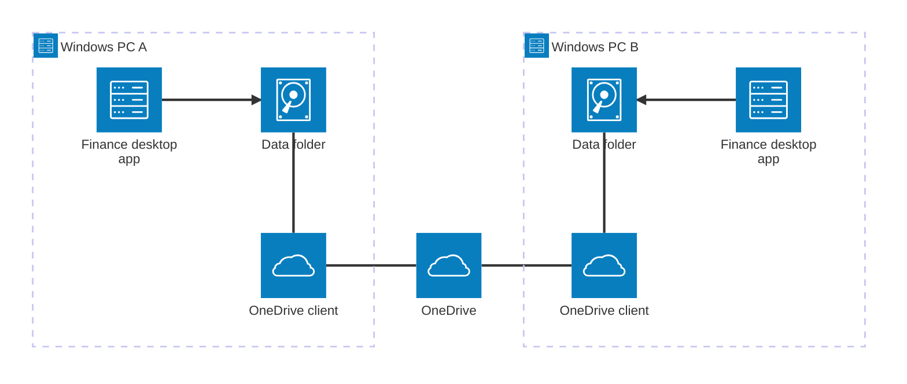
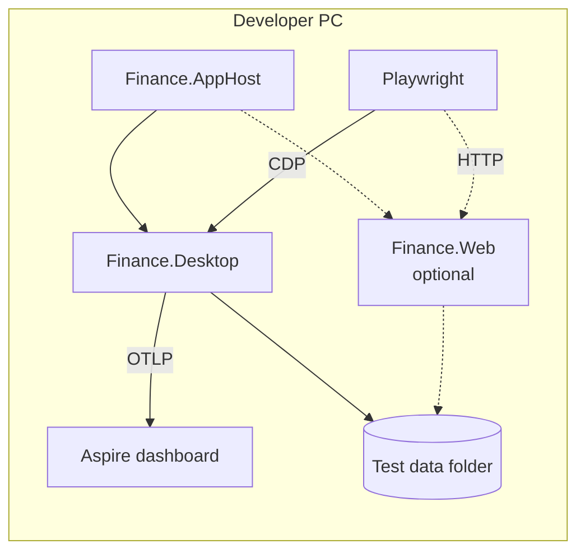

# 07. Deployment View

```meta
status: draft
related: [.devbook/arc42/05-building-block-view.md]
```

```annotation
kind: flag
author: "claude/chapter-review"
date: 2026-10-21
body: |
  [major] Both deployment pictures are Mermaid (architecture-beta under Production, a flowchart under Development), but devbook-arc42.md says deployment is shown as a C4 `deployment` view defined in workspace.dsl and embedded here, with Mermaid only inside one element. workspace.dsl has no deploymentNode and no deployment view, so nothing in the model backs this chapter. Settle: add deploymentEnvironment "Production" and "Development" (Windows PC, Data folder, OneDrive client, Developer PC nodes) to workspace.dsl, embed them here as c4:<key> images, and drop the two Mermaid blocks.
```

Finance has two environments: the user's own Windows PCs, and the developer's machine. No
part of Finance is deployed to a server or a cloud subscription.

## Production

```meta
status: draft
related: [.devbook/arc42/adr/storage.md, .devbook/arc42/06-runtime-view.md#continue-on-another-pc]
```



```annotation
kind: suggestion
author: "claude/prose-check"
date: 2026-10-21
quote: "architecture-beta"
body: |
  [minor] Prose (Mermaid architecture): This is a deployment diagram of PCs, the OneDrive client and OneDrive; use a deployment view in 07 (add it to workspace.dsl).
```

| Node | Runs | Notes |
| --- | --- | --- |
| Windows PC | `Finance.Desktop` and its libraries | One installation per PC. How it is packaged and installed is open, see [11](11-risks-and-technical-debt.md#open-questions). |
| Data folder | The JSON files | A folder the user picks under their OneDrive. Its layout is in [08](08-crosscutting-concepts.md#persistence). |
| OneDrive client | Microsoft's sync client | Replicates the data folder. Finance neither starts nor controls it. |
| OneDrive | Microsoft's cloud storage | Holds the replicated copy. It is the user's own account, not a Finance resource. |

```annotation
kind: suggestion
author: "claude/chapter-review"
date: 2026-10-21
quote: "A folder the user picks under their OneDrive."
body: |
  [minor] The node table leaves out two things a deployment needs. First, 11 R2 makes "keep the data folder always available offline" the mitigation for Files On-Demand placeholders, which is a setting on this node. Second, the data-folder path is per machine (08#configuration), so PC B has to be pointed at the same OneDrive folder on its own first start. Neither is stated here. Settle: add both to the Data folder row or to the paragraph under the table.
```

A second PC is optional. With one PC, OneDrive still gives an off-machine copy and its file
version history. The AppHost and the Aspire dashboard are absent in production, so the
telemetry ServiceDefaults wires has no collector to send to.

```annotation
kind: flag
author: "claude/chapter-review"
date: 2026-10-21
quote: "the telemetry ServiceDefaults wires has no collector to send to"
body: |
  [major] This sentence implies Finance.ServiceDefaults ships inside the installed app, which matches adr/orchestration.md (ServiceDefaults reaches the MAUI head through an IMauiInitializeService). But 05-building-block-view.md#development-harness says the harness projects, ServiceDefaults included, "never ship to the user", and adr/orchestration.md says "Nothing from Aspire ships to the user". The production node row ("Finance.Desktop and its libraries") does not settle which is true. Settle: name Finance.ServiceDefaults (and its OpenTelemetry packages) in the Windows PC "Runs" cell, and have 05 and the orchestration record say it ships with export switched off.
```

## Development

```meta
status: draft
related: [.devbook/arc42/05-building-block-view.md#development-harness, .devbook/arc42/06-runtime-view.md#development-run-with-playwright]
```



```annotation
kind: suggestion
author: "claude/prose-check"
date: 2026-10-21
quote: "flowchart LR"
body: |
  [minor] Prose (Mermaid architecture): The flowchart draws deployment nodes and the projects on them; use a deployment view in 07 (add it to workspace.dsl).
```

Everything runs on the developer's PC. The AppHost starts the application against a test data
folder outside OneDrive, so development and test runs never touch the real records. CI runs the
same projects on a Windows runner; the exact CI workflow is not designed yet.

```annotation
kind: question
author: "claude/chapter-review"
date: 2026-10-21
quote: "the exact CI workflow is not designed yet"
body: |
  [minor] Can the end-to-end level run on a hosted Windows runner at all? It needs the WebView2 runtime, an interactive desktop session for the MAUI window, and a CDP port. 08#testability already fixes a CI order (unit, integration, architecture, then end to end), yet 11#open-questions has no row for CI. Settle: answer here or add an open question in 11 that names the E2E-on-CI risk and its owner.
```

```annotation
kind: suggestion
author: "claude/prose-check"
date: 2026-10-21
quote: "The AppHost starts the application against a test data"
body: |
  [minor] Prose (synonym): "Test data folder" here, "throwaway data folder" in chapters 05, 06 and 08; pick one term and use it in all of them.
```
